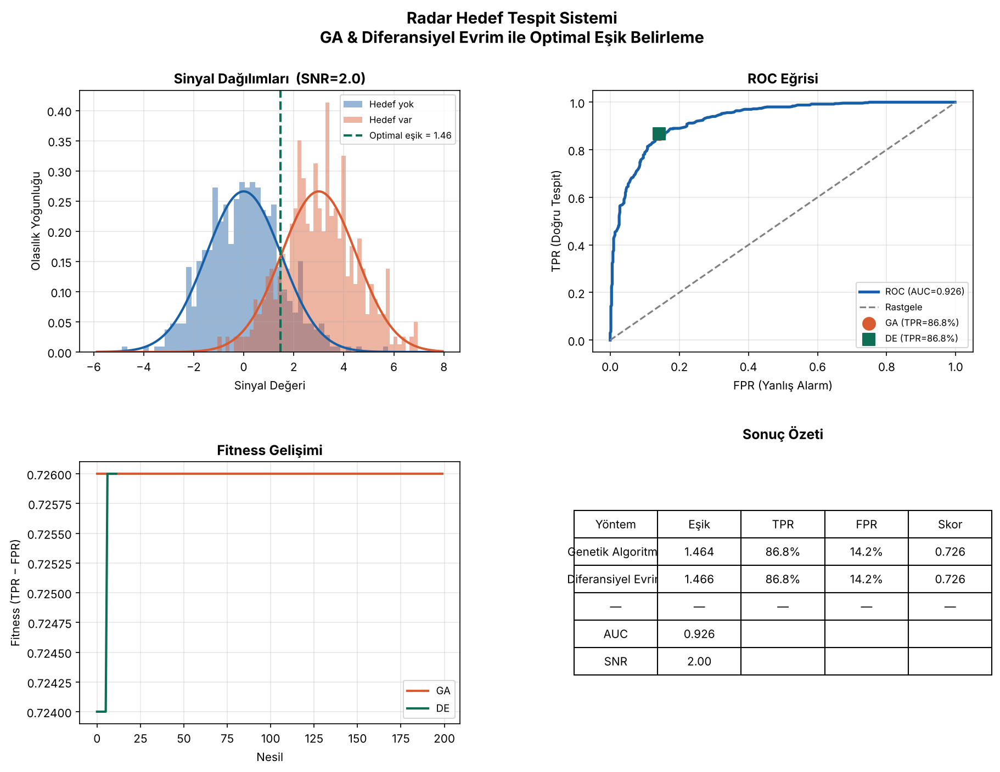

# Radar Hedef Tespit Sistemi — Evrimsel Optimizasyon

## Proje Hakkında
Bu projede bir radar sisteminin hedef tespitinde kullandığı **karar eşiği**, evrimsel optimizasyon yöntemleriyle belirlenmiştir. Amaç, yanlış alarm (false positive) ve kaçırma (false negative) hatalarını dengeleyen optimal eşik değerini bulmaktır.

📓 Kod ve grafikler: [radar_optimizasyon.ipynb](radar_optimizasyon.ipynb)

## Problem Tanımı
Radar sistemleri hedef tespitinde iki temel hatayla karşılaşır:

| Hata Türü | Açıklama |
|-----------|----------|
| **Yanlış Alarm** | Hedef yokken "var" demek |
| **Kaçırma** | Hedef varken "yok" demek |

Bu iki hata birbirine bağlıdır — birini azaltmak diğerini artırır. Optimal eşik değeri bu dengeyi en iyi kuran noktadır.

## Kullanılan Yöntemler
| Yöntem | Açıklama |
|--------|----------|
| **Genetik Algoritma (GA)** | PyGAD kütüphanesi ile evrimsel arama |
| **Diferansiyel Evrim (DE)** | SciPy ile sürekli uzayda optimizasyon |

Eşik, **TPR − FPR** (doğru tespit oranı eksi yanlış alarm oranı) skorunu maksimize edecek şekilde aranmıştır.

## Sinyal Modeli
Radar gürültüsü Gaussian dağılımla modellendi (Merkezi Limit Teoremi gereği):

- Hedef YOK: X ~ N(0, σ²)
- Hedef VAR: X ~ N(μ, σ²)
- SNR = μ/σ = 2.0 (orta zorluk senaryosu; μ = 3.0, σ = 1.5)

Gerçek radar verisi gizlilik sınıflandırması nedeniyle kamuya açık olmadığından **Monte Carlo simülasyonu** ile sentetik veri üretilmiştir (500 hedefli, 500 hedefsiz toplam 1000 ölçüm, `seed=42`).

## Sonuçlar

| Yöntem | Optimal eşik | TPR | FPR | Skor (TPR − FPR) |
|--------|-------------|-----|-----|------------------|
| Genetik Algoritma | 1.4642 | %86.8 | %14.2 | 0.7260 |
| Diferansiyel Evrim | 1.4655 | %86.8 | %14.2 | 0.7260 |

- **ROC-AUC = 0.926**, SNR = 2.0 için "çok iyi" ayırt edicilik düzeyi.
- İki algoritma da aynı skora ulaştı; eşikler arasındaki fark yalnızca 0.0014. Çıkan eşik, ızgara taramasıyla bulunan en iyi skorla da aynı (0.7260), yani her iki yöntem de global optimuma ulaştı.
- Problem tek boyutlu ve pürüzsüz olduğu için yöntemler arasında fark çıkmaması beklenen bir durum. Yöntemlerin farkı çok parametreli problemlerde belirginleşir.



### Sınırlılıklar
- Veri sentetiktir, gerçek radar ölçümleri kullanılmamıştır.
- Gürültünün Gaussian olduğu varsayılmıştır; yağmur ve deniz yüzeyi gibi ortamlarda dağılım farklıdır.
- Tek parametreli (eşik) bir problem ele alınmıştır.
- SNR sabit tutulmuştur; gerçek ortamda hedefe ve mesafeye göre değişir.

## Kullanılan Teknolojiler
- Python 3
- NumPy, SciPy
- Matplotlib
- PyGAD

## Çalıştırma
```bash
pip install numpy scipy matplotlib pygad jupyter
jupyter notebook radar_optimizasyon.ipynb
```
Veri notebook içinde üretildiği için ek dosya gerekmez.
